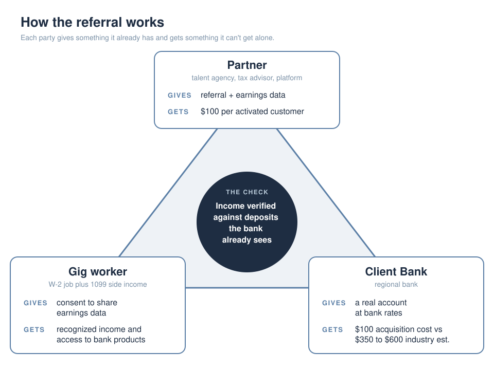

# Gig Worker Referral Platform

**The bank already banks these people. It just can't see their income.**

A one-state referral pilot that helps a regional bank recognize documented side income from gig work, so dual-income customers stop getting auto-rejected and the bank keeps them as they grow into small business owners.

Client: Client Bank (anonymized for publishing). Team project.

[Live prototype](https://gig-worker-referral-platform.lovable.app) · [Evidence page](evidence.md) · [Prototype walkthrough](docs/prototype.md)

---

## What was broken

Two out of three independent workers earn dual income: a W-2 paycheck plus 1099 side income. The bank's income check reads payroll only. The side income is fully documented (1099s, platform statements, deposits that land in the customer's own account), but the system doesn't read it, so it counts as zero. The customer applies for a loan, gets scored on half their income, and gets an automatic no.

That costs the bank twice. It loses the loan today, and it loses the business account later. Gig workers are about three times more likely than the general population to start a business. When they do, they open business accounts with whoever served them first, and right now that is usually a fintech.

The bank's own data team confirmed these customers are already in the base. Nobody tags them, so nobody can count them.

## How we approached it

**Reframe.** The first instinct was a new loan product for gig workers. We dropped it. The documents already exist and the bank already sees the deposits. The gap is recognition, not credit, so the fix should help the bank read income it already has.

**Mechanism.** A referral exchange between three parties (diagram above):
- The gig worker gives consent to share earnings data and gets recognized income and access to normal bank products.
- A partner who already knows the worker's earnings (a talent agency, tax advisor or platform) refers them and gets $100 per activated customer.
- The bank gives a real account at bank rates and gets a customer for a target of about $100, against industry estimates of $350 to $600.
- In the middle, the bank checks the referred income against deposits it already sees, using its existing data tools.

**Research and compliance checks.** We ran a 39-person survey of gig and independent workers and eight interviews: four with industry and banking people (a senior data analyst inside the client bank, a former debt investment analyst, an industry advisor with a CIO and consulting background, and a technology executive at a creator-marketing agency) and four with gig workers. A reviewer with a legal background also checked the referral design. Lending is a compliance-heavy space, so we tested the idea with people who would have to approve it, not only the people it would serve. The pain points repeated across every conversation: invisible income, tax complexity across many payers, and irregular pay that monthly-consistency rules punish.

**Pilot design.** One state, a 90-day launch plan, existing products and data tools, no new hires, and a partner payout paid only on activation. Go/no-go checkpoints at month 3 (at least 40% of referrals activate) and month 12 (scale decision based on activation, delinquency and cross-product use).

**Prototype.** We built a working prototype of the referral flow across four roles so the bank could click through it instead of reading about it. The Platform Partner submits a referral, the Gig Worker reviews and consents, the Bank Admin tracks the pipeline, and Payments Ops sees which partner payouts are due.

### Judgment calls along the way
- **We caught the wrong partner type.** The lead partner contact turned out to be a brand-side marketing agency, which can't vouch for anyone's income. We named it in the final pitch as the most material open item instead of quietly patching it.
- **We moved from person-to-person referrals to business referrals.** The legal review flagged risk in individuals referring other individuals. A business partner vouching for earnings clears that concern and has skin in the game.
- **We kept existing customers as the first funnel.** The bank's existing data tools can flag current customers with gig-deposit patterns. Starting with people the bank already has is cheaper and easier to defend than starting with new ones.
- **We opened with recognition, not lending.** An early draft led with a loan. That reads the logic backward, so the story starts with income the bank can't see.
- **We framed the base partner payout as a flat acquisition cost of about $100 per activated customer,** and got the industry benchmark sourced before the final pitch.
- **We built the payout logic into the prototype.** The Payments Ops screen pays a partner only after a customer activates, so the cost model is something you can click through, not a claim on a slide.
- **We redesigned the core diagram** from a flow of arrows to a filled triangle, because the arrow version didn't show what each party gives and gets in the five seconds an executive spends on it.

## What changed

We handed the bank a pilot recommendation scoped to be defensible:
- one state, which keeps the regulatory surface to one state regulator plus federal
- existing products and the bank's existing data tools, so no new systems
- partner payout paid only on activation, so cost moves with results
- a KPI tree from activity to outcome, with clear go/no-go checkpoints
- a risk register that names what is still open

Open risks at handoff: no named internal owner, partner deal not signed, platform data sharing not agreed (deposit history used as a workaround), and default risk from irregular income (held by conservative loan limits, a 12-month income average and the W-2 as a buffer).

## What this repo contains

This repo is the case file: the problem, the approach, the evidence and a screen-by-screen walkthrough. The working prototype runs live at the link above, with a demo login on its sign-in page. Its source code is kept private.

| Path | What it is |
|---|---|
| `README.md` | The case: what was broken, how we approached it, what changed |
| `evidence.md` | Sources and figures behind the key claims |
| `docs/prototype.md` | Walkthrough of the prototype across all four roles, one screen per step |
| `assets/screenshots/` | The nine walkthrough screens |
| `triangle.svg` | The three-way referral exchange diagram |

## Links
- Live prototype: https://gig-worker-referral-platform.lovable.app (demo login is shown on the sign-in page)
- Evidence page: [evidence.md](evidence.md)
- Prototype walkthrough: [docs/prototype.md](docs/prototype.md)
