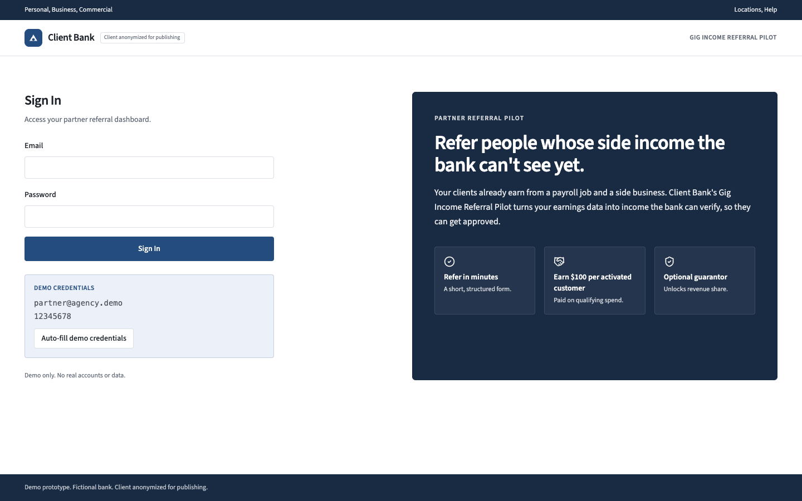
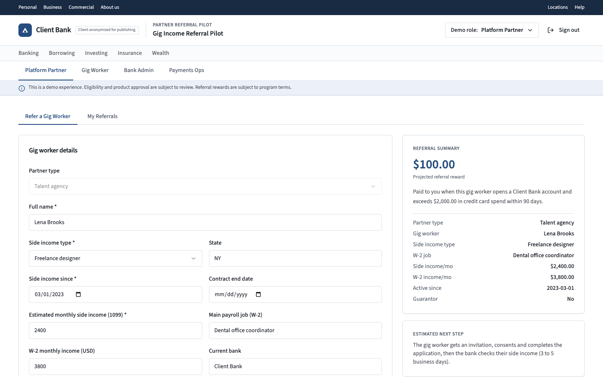
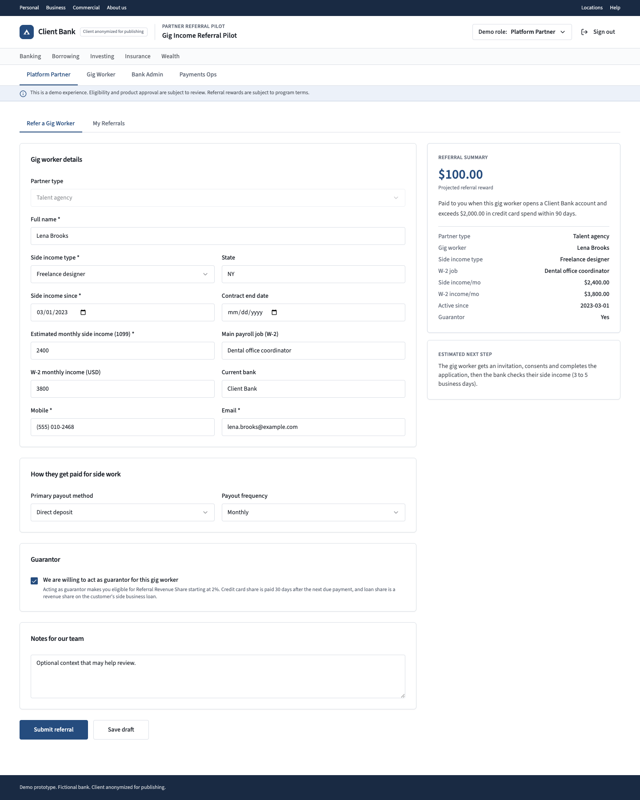
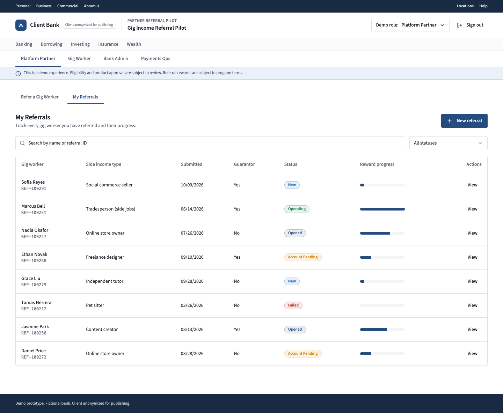
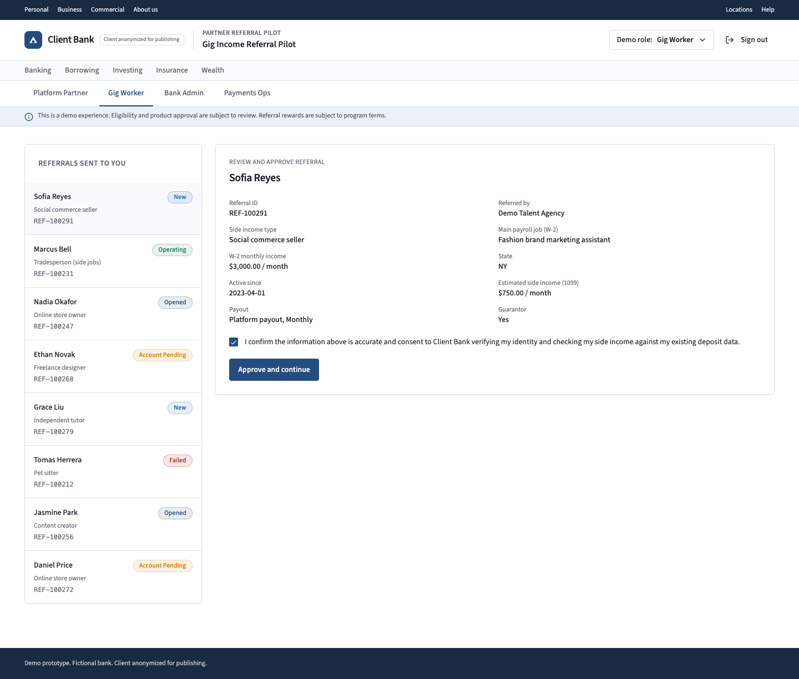
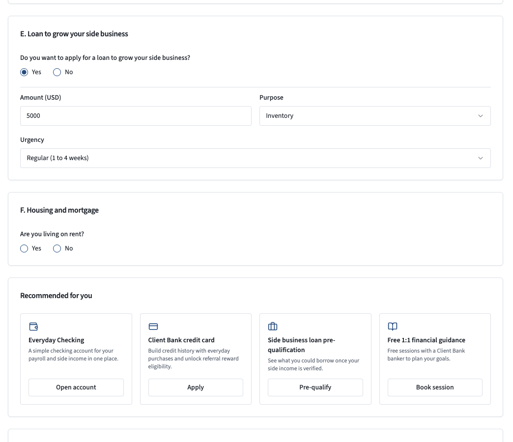
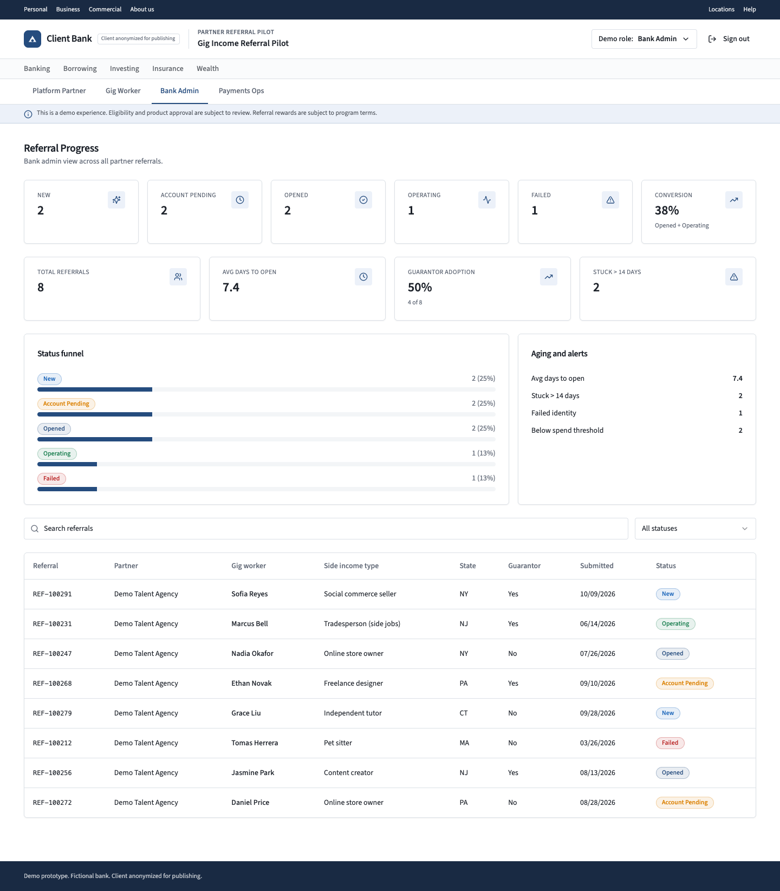
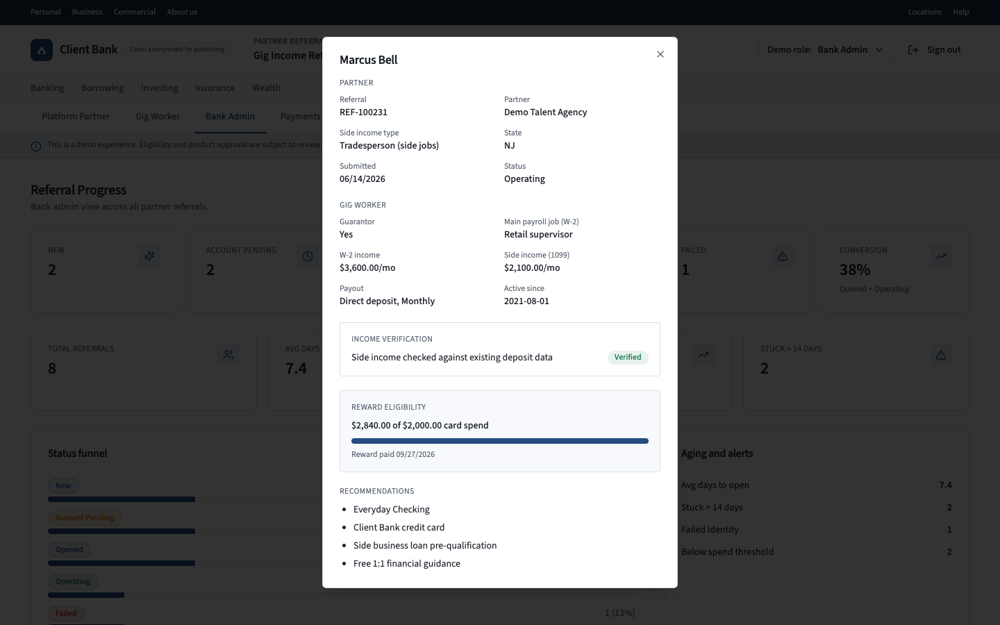
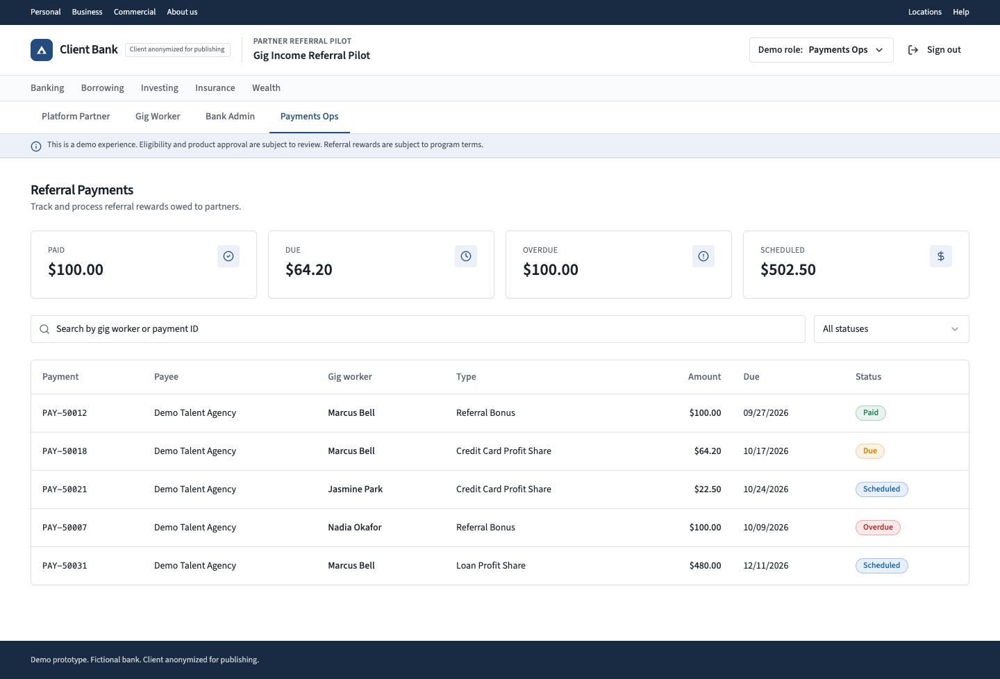

# Prototype walkthrough

[Back to README](../README.md)

I built this prototype so the bank could click through the referral flow instead of reading about it on a slide. It covers the four roles in the pilot: Platform Partner, Gig Worker, Bank Admin and Payments Ops. Every person, partner and number in it is made up, and nothing is stored on a server. The program inside the app is called the Gig Income Referral Pilot, which reads as the bank's own name for it.

[Open the live prototype](https://gig-worker-referral-platform.lovable.app). The demo login is shown on the sign-in page, and you can switch roles from the menu at the top right.

---

## 1. Sign in

The partner signs in to a referral dashboard. The panel on the right is the pitch to the partner in one line: refer people whose side income the bank can't see yet.

## 2. Refer a gig worker

The partner fills in a short form: side income type, how long it has been running, monthly 1099 income and the W-2 job next to it. The summary on the right updates as they type, so they see the full income picture the bank would otherwise miss.

## 3. Reward summary and guarantor option

The base reward of $100 only pays out when the referral turns into an active customer. In the prototype that means the account is open and the customer passes $2,000 in card spend within 90 days. The form also sketches an optional guarantor track, with its own terms, for partners willing to back the worker.

## 4. The partner's referral list

Every referral shows its status and how close it is to paying out. The partner never has to ask the bank where a referral stands.

## 5. Gig worker reviews and consents

The worker sees exactly what the partner sent about them and confirms it before anything moves. Consent is the step that lets the bank check the side income against deposits it already sees. Nothing happens without it.

## 6. Application with a side business loan

After consent, the worker finishes a normal application. They can ask for a loan to grow the side business, and the purpose has to be inventory, equipment or marketing. That gate is there because a real risk in the pilot is loans drifting into everyday spending. The same screen suggests other products the worker can use once the income is recognized.

## 7. Bank Admin dashboard

The bank sees every referral across partners in one place: how many are at each stage, how many convert, how long accounts take to open and which ones are stuck. These are the early numbers the pilot would be judged on at the month 3 checkpoint.

## 8. Income verification on a single referral

Opening a referral shows the core of the idea. The side income is checked against deposit data the bank already holds, and the result is a clear verified or pending. Below it, the reward bar shows whether the partner has earned the payout yet.

## 9. Payments Ops

I built the payout logic into this screen so the cost model is something you can click through. The base reward is only paid after the customer activates. The table also lists the optional guarantor shares, so the team sees everything that is paid, due, overdue and scheduled in one place.
